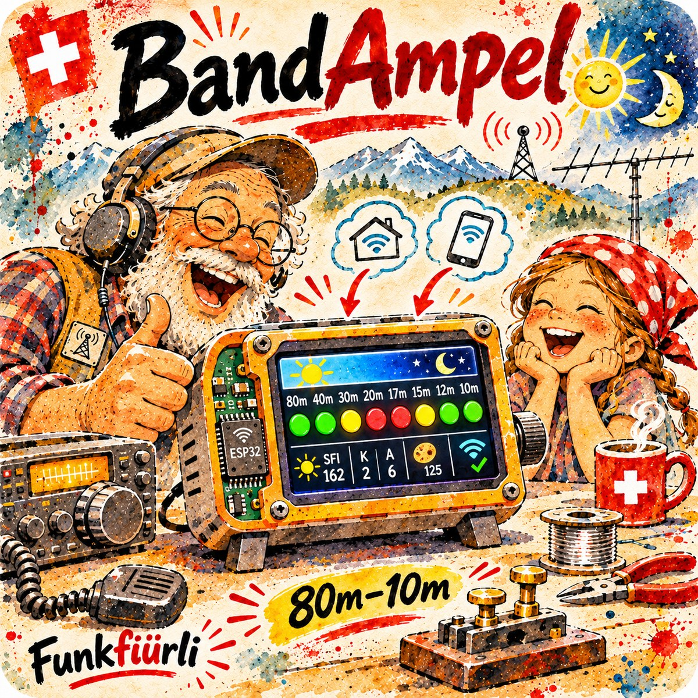
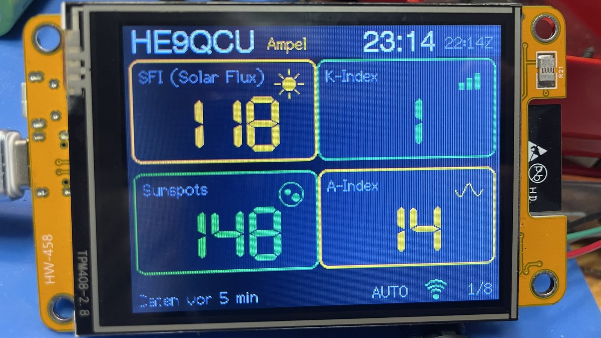
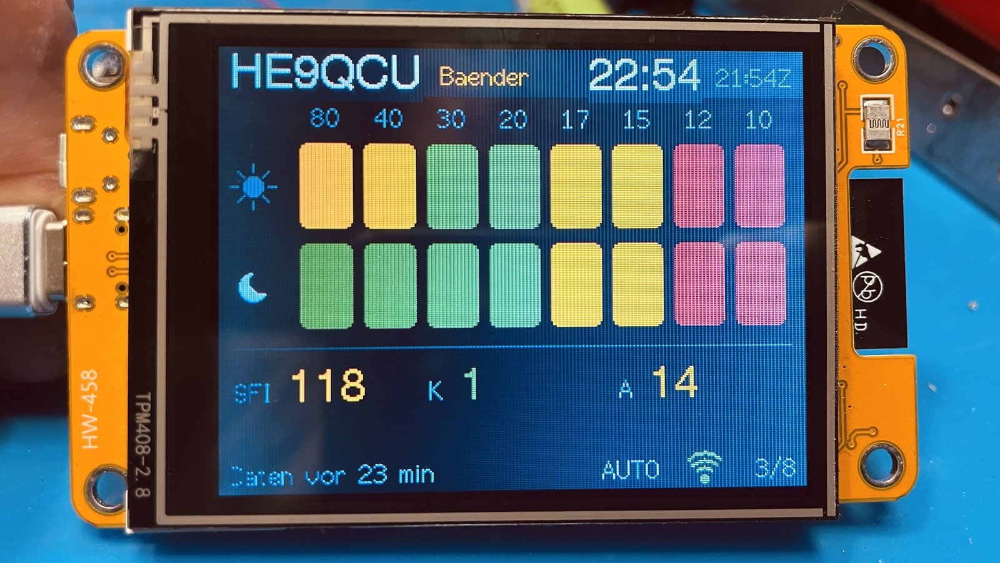

# Bandampel

*HF-Ausbreitung auf einen Blick: Welches Band läuft gerade, und wofür?*

Ein kleines ESP32-Gerät mit 2,8-Zoll-Farbdisplay, das Solardaten und Bandbedingungen für den Amateurfunk als Farbampel darstellt: 80m bis 10m, Tag und Nacht, grün, gelb, rot. Dazu SFI, K-Index, A-Index, Sunspots und weitere Werte. Das Gerät holt die Daten selbst per WLAN (Heimnetz oder Handy-Hotspot).

## Status

Die aktuelle Version steht im [CHANGELOG.md](CHANGELOG.md). Die Firmware läuft auf dem CYD und ist eingefroren, es gibt nur noch Fehlerbehebungen.

| Phase | Inhalt | Stand |
|---|---|---|
| 1 | Firmware für das fertige Board ESP32-2432S028 ("Cheap Yellow Display", CYD) | fertig, eingefroren (1.18.x) |
| 2 | Akkubetrieb mit 6,3 mm Buchse (5 V 1 A) zum Laden | in Planung (Vorschlag) |
| 3 | 3D-gedrucktes Gehäuse als Komplettlösung | geplant |
| 4 | Eigene Trägerplatine «Bandampel Neo» (Drehgeber, Entlastung der Stecker) | offen |

Der aktuelle Stand steht in [STATUS.md](STATUS.md).

## So sieht es aus

Alle 8 Seiten und das Web-Menü zeigt das [Benutzerhandbuch](docs/Benutzerhandbuch.md).

## Funktionen

- 8 Seiten (Ampel, Sonne, Bänder, Modus, Live, Details, Info, Lizenz), automatischer Wechsel oder per Touch
- Übersicht mit Farbkacheln für SFI, K, A und Sunspots
- Bandbalken 80m bis 10m, Tag und Nacht, getrennt für SSB und CW
- Live-Seite aus gemessenen WSPR-Spots, inklusive 160m
- Sonnenseite mit Auf- und Untergang, Tageslänge und Grayline
- Detailseite: X-Ray, Sonnenwind, Magnetfeld, Rauschen
- Web-Menü mit 7 Reitern (Rufzeichen, Locator, WLAN, Helligkeit, Seiten), bis zu 5 WLAN-Netze, Notfall-WLAN
- Automatische Helligkeit nach Lichtsensor, Nachtmodus
- BOOT-Taste 10 s: Werkseinstellung
- Geplant: Drehgeber (mit eigener Trägerplatine), Akkubetrieb

### Was zeigen die 8 Seiten?

| Nr | Seite (Name in der Kopfzeile) | Was man sieht | Kurz erklärt |
|---|---|---|---|
| 1 | Ampel | SFI, K-Index, A-Index und Sunspots als 4 Kacheln mit Farbrahmen | Die wichtigsten Sonnenwerte auf einen Blick. Hoher SFI und niedrige K und A sind gut. Der Rahmen zeigt die Bewertung. |
| 2 | Sonne | Sonnenbogen mit Aufgang, Untergang, Tageslänge und Countdown | Zeigt, wo die Sonne steht (nachts der Mond). In der Grayline, der Dämmerungszone, laufen tiefe Bänder oft besonders gut. |
| 3 | Baender | 8 Bänder von 80m bis 10m als Farbbalken für Tag und Nacht, dazu SFI, K und A | Prognose pro Band. Die Zeile, die gerade gilt (Tag oder Nacht), leuchtet. 160m fehlt, die Quelle kennt es nicht. |
| 4 | Modus | Dieselben 8 Bänder, getrennt für SSB und CW (mit Digital wie FT8), je Tag und Nacht | CW und Digital kommen mit schwachen Signalen aus und werden eine Stufe besser bewertet. Faustregel, keine Prognose. |
| 5 | Live | 9 Balken von 160m bis 10m mit der Zahl der WSPR-Meldungen der letzten 30 Minuten | Hier wird gemessen, nicht prognostiziert: Wie viel ist gerade wirklich auf dem Band los? Region standardmässig Mitteleuropa. |
| 6 | Details | 4 Karten: X-Ray (Flares), Sonnenwind, Magnetfeld Bz, Rauschen | Was sonst auf die Ausbreitung drückt, mit Wertung wie «ruhig» oder «erhöht» und Farbrahmen. |
| 7 | Info | Firmware-Version, WLAN-Name, IP-Adresse, Signalstärke, Gerätename, Alter der Daten, Laufzeit | Die technische Seite. Hier steht die Adresse für das Web-Menü. |
| 8 | Lizenz | Version, Urheber, Lizenzen, Datenquellen und ein QR-Code | Mit dem Handy scannen führt zum Projekt auf GitHub. |

Auf jeder Seite stehen oben das Rufzeichen, der Seitenname und die Uhrzeit (Ortszeit und UTC). Unten stehen das Alter der Daten, AUTO oder HALT (Seitenwechsel), das WLAN-Symbol und die Seitennummer. Farben: Grün gut, Gelb mittel, Rot schlecht, Grau keine Daten.

## Hardware

Erste Phase: ESP32-2432S028 (ESP32, 2,8 Zoll, 240x320, resistiver Touch, Display ILI9341). Die Display-Variante (ILI9341 oder ST7789) ermittelt das Tool in [firmware/tools/cyd_id](firmware/tools/cyd_id).

## Datenquellen

Die Bandprognose stammt von HamQSL (N0NBH), Rohdaten ergänzend von NOAA SWPC. Bitte die Quellen nicht öfter als nötig abfragen (alle 30 Minuten oder seltener reicht, HamQSL aktualisiert ca. alle 3 Stunden). Die Daten sind für nicht-kommerzielle Nutzung gedacht. 160m liefert HamQSL nicht, deshalb steht 160m nur auf der Live-Seite. Die Live-Aktivität stammt aus gemessenen WSPR-Spots von wspr.live (Abruf alle 15 Minuten, bitte nicht öfter).

## Nachbauen

Mit einem fertigen CYD-Board (ESP32-2432S028), einem USB-Kabel und etwa 30 Minuten: [docs/Nachbauen.md](docs/Nachbauen.md). Beschrieben sind beide Wege, Arduino IDE (mit Maus) und arduino-cli, für Windows und macOS, samt Flash-Aufteilung «Huge APP» und erstem Start.

## Benutzerhandbuch

Funktionsumfang, Bedienung und Einstellungen: [docs/Benutzerhandbuch.md](docs/Benutzerhandbuch.md). Technik zum Selbstbau: [docs/Firmware_V1.md](docs/Firmware_V1.md).

## Platinen und Bausätze

Bastlerprojekt. Platinen und Bausätze gibt es auf Anfrage zum Materialpreis, solange Vorrat, ohne Gewährleistung und ohne CE-Prüfung. Betrieb auf eigene Verantwortung. Anfragen über einen «Issue» auf GitHub oder an HE9QCU. Gemeinsame Lötworkshops (zum Beispiel im Funkclub oder Fab Lab) sind möglich, das Material wird zum Selbstkostenpreis weitergegeben. Es gibt keinen Verkauf mit Gewinn. Die Datenquellen (HamQSL, NOAA, wspr.live) sind für nicht-kommerzielle Nutzung gedacht.

## Lizenzen

Firmware GPL-3.0-only, Hardware CERN-OHL-P-2.0, Dokumentation CC-BY-4.0. Details in [LICENSE.md](LICENSE.md).

## English summary

Bandampel is a small ESP32 device with a 2.8 inch colour display that shows HF propagation for ham radio as a traffic light: solar data and band conditions from 80m to 10m, day and night. It fetches the data over Wi-Fi (home network or phone hotspot). Phase 1 (firmware for the ESP32-2432S028 "Cheap Yellow Display") is done and frozen (1.18.x). Planned: battery operation with a charger, a 3D-printed case, and later a custom carrier board. Firmware is GPL-3.0-only, hardware CERN-OHL-P-2.0, documentation CC-BY-4.0. Band forecasts come from HamQSL, please poll sparingly. Hobby project: boards and kits are available on request at material cost while stocks last, without warranty and without CE conformity assessment, use at your own risk. Contact via a GitHub issue or call sign HE9QCU. The data sources are intended for non-commercial use.

Build guide (German): docs/Nachbauen.md.

Copyright (c) 2026 FerienBSD aka Marcel Sauder
