<!-- SPDX-License-Identifier: CC-BY-4.0 -->
<!-- Copyright (c) 2026 FerienBSD aka Marcel Sauder -->

# Bandampel: Das Benutzerhandbuch

*Gilt für die Firmware 1.19. Die Ampel für den Äther: Was läuft gerade auf Kurzwelle, und wofür?*

Dieses Handbuch ist für alle gedacht: für Funkamateure mit 40 Jahren Erfahrung genauso wie für angehende Funkamateure (zum Beispiel in der Prüfungsvorbereitung) und für die Person, die sich fragt, warum sich ihre Familie dauernd über «S-Meter» und «K-Index» unterhält. Die Seiten heissen auf dem Gerät mit den üblichen englischen Funkerbegriffen (Solar, Bands, Mode ...). Was sie bedeuten, steht bei jeder Seite und im Glossar am Ende. Es ist nach dem Prinzip gebaut: erst was die Bandampel kann, dann wie man sie bedient, dann wie man sie einstellt. Bei Problemen hilft das Kapitel «Wenn etwas klemmt» weiter hinten.

Die Bilder sind Fotos vom echten Gerät. Sie liegen in `docs/bilder/`. Die Kamera gibt Gelb auf dem Display teils weiss und Rot violett wieder. Massgebend sind die Farben der Legende im Text.

---

## 1. Was ist die Bandampel?

Ein kleiner Kasten mit Bildschirm, der dir auf einen Blick sagt, ob sich das Einschalten des Funkgeräts heute lohnt. Grün heisst: Los! Gelb heisst: Mit Geduld und guter Antenne. Rot heisst: Kaffee trinken und die Antenne in Ruhe lassen.

Das Gerät holt sich die Daten selbst aus dem Internet (über dein WLAN oder den Hotspot deines Handys), rechnet ein bisschen und malt dir daraus Farben. Du musst nichts wissen, nichts rechnen und keine Tabellen lesen. Wer es doch wissen will, findet unten für jede Zahl eine Erklärung.

**Warum Sonnenwerte?** Kurzwellensignale (HF, etwa 3 bis 30 MHz) werden von der Ionosphäre zur Erde zurückgeworfen, einer Schicht in grosser Höhe. Die Sonne bestimmt, wie stark diese Schicht ionisiert ist. Viel Sonnenaktivität (hoher SFI, viele Sunspots) öffnet tagsüber die oberen Bänder (15, 12, 10 m). Nachts sind die tiefen Bänder (80 m, 160 m) besser. Gestörte Tage (hoher K-Index, starke Flares) dämpfen die Ausbreitung. Fachwort dafür: **Propagation**. Genau diese Werte zeigt die Bandampel als Farben.

---

## 2. Was kann sie?

- **8 Seiten**, die automatisch durchlaufen oder per Fingertipp wechseln.
- **Prognose für 8 Bänder** (80 m bis 10 m), getrennt für Tag und Nacht, als Farbbalken.
- **Prognose für SSB und CW** (Sprechfunk und Morsen samt Digital wie FT8), jeweils Tag und Nacht.
- **WSPR-Seite (Live-Aktivität)**: Was gerade wirklich auf den Bändern los ist, gemessen aus WSPR-Meldungen, auch für 160 m.
- **Greyline-Seite (Sonne)**: Sonnenaufgang, Sonnenuntergang, Tageslänge und ein Hinweis auf die **Grayline**.
- **Space Wx (Weltraumwetter)**: Flares, Sonnenwind, Magnetfeld, Rauschen.
- **Uhr** mit Ortszeit und UTC, dein **Rufzeichen** in der Kopfzeile.
- **Automatische Helligkeit** nach Umgebungslicht, damit es nachts nicht blendet und kaum Strom braucht.
- **Web-Menü** im Browser: alles einstellen, ohne Kabel und ohne Programmieren.
- **Notfall-WLAN**, falls das Gerät sein Netz verliert und du es neu einrichten musst.
- **Mehrere Netze** (zum Beispiel Zuhause und Handy-Hotspot), das Gerät wählt selbst.
- **Mehrere Geräte** gleichzeitig im Haus: Jede Bandampel bekommt eine eigene Nummer.

### Die 8 Seiten im Überblick

Das sieht man auf den Seiten und was es bedeutet. Die Einzelheiten stehen im nächsten Kapitel. Dort steht der Name auf dem Gerät zuerst, dahinter die deutsche Bezeichnung, zum Beispiel «Solar (Übersicht)» oder «Mode (Betriebsart)».

| Nr | Seite (Name in der Kopfzeile) | Was man sieht | Kurz erklärt |
|---|---|---|---|
| 1 | Solar | SFI, K-Index, A-Index und Sunspots als 4 Kacheln mit Farbrahmen | Die wichtigsten Sonnenwerte auf einen Blick. Hoher SFI und niedrige K und A sind gut. Der Rahmen zeigt die Bewertung. |
| 2 | Greyline | Sonnenbogen mit Aufgang, Untergang, Tageslänge und Countdown | Zeigt, wo die Sonne steht (nachts der Mond). In der Grayline, der Dämmerungszone, laufen tiefe Bänder oft besonders gut. |
| 3 | Bands | 8 Bänder von 80m bis 10m als Farbbalken für Tag und Nacht, dazu SFI, K und A | Prognose pro Band. Die Zeile, die gerade gilt (Tag oder Nacht), leuchtet. 160m fehlt, die Quelle kennt es nicht. |
| 4 | Mode | Dieselben 8 Bänder, getrennt für SSB und CW (mit Digital wie FT8), je Tag und Nacht | CW und Digital kommen mit schwachen Signalen aus und werden eine Stufe besser bewertet. Faustregel, keine Prognose. |
| 5 | WSPR | 9 Balken von 160m bis 10m mit der Zahl der WSPR-Meldungen der letzten 30 Minuten | Hier wird gemessen, nicht prognostiziert: Wie viel ist gerade wirklich auf dem Band los? Region standardmässig Mitteleuropa. |
| 6 | Space Wx | 4 Karten: X-Ray (Flares), Sonnenwind, Magnetfeld Bz, Rauschen | Was sonst auf die Ausbreitung drückt, mit Wertung wie «ruhig» oder «erhöht» und Farbrahmen. |
| 7 | Info | Firmware-Version, WLAN-Name, IP-Adresse, Signalstärke, Gerätename, Alter der Daten, Laufzeit | Die technische Seite. Hier steht die Adresse für das Web-Menü. |
| 8 | About | Version, Urheber, Lizenzen, Datenquellen und ein QR-Code | Mit dem Handy scannen führt zum Projekt auf GitHub. |

Auf jeder Seite stehen oben das Rufzeichen, der Seitenname und die Uhrzeit (Ortszeit und UTC). Unten stehen das Alter der Daten, AUTO oder HALT (Seitenwechsel), das WLAN-Symbol und die Seitennummer. Farben: Grün gut, Gelb mittel, Rot schlecht, Grau keine Daten.

---

## 3. Die Seiten

Jede Seite hat oben eine **Kopfzeile** und unten eine **Fusszeile**. Dazwischen steht der Inhalt.

### Kopfzeile

Links dein Rufzeichen (oder «BANDAMPEL», wenn du keins eingetragen hast), dahinter in Gelb der Name der Seite: Solar, Bands, Mode, WSPR, Space Wx, Greyline, Info oder About. Im Web-Menü heissen die Haken genauso. Rechts die Uhrzeit: gross die Ortszeit, klein dahinter die UTC-Zeit mit einem «Z» (Funker sprechen von «Zulu»).

### Fusszeile

- **Links:** Wie alt die Daten sind, zum Beispiel «Daten vor 2 h 5 min». Das ist kein Fehler: Die Quelle aktualisiert sich nur alle paar Stunden.
- **AUTO oder HALT:** AUTO heisst, die Seiten wechseln von selbst. HALT heisst, die Bandampel bleibt auf der gewählten Seite stehen.
- **WLAN-Symbol:** 3 Bögen. Grün heisst verbunden, die Zahl der leuchtenden Bögen zeigt die Stärke. Rot heisst: keine Verbindung.
- **Rechts:** Seitenzahl, zum Beispiel «3/8».

### Die Farben

| Farbe | Bedeutung | Merksatz |
|---|---|---|
| Grün | gut | Los! |
| Gelb | mittel | Mit Geduld |
| Rot | schlecht | Kaffeepause |
| Grau | keine Daten | Das Gerät denkt noch nach |

### Seite 1: Solar (Übersicht)

4 grosse Kacheln mit den wichtigsten Zahlen der Sonne:

- **SFI** (Solar Flux): Wie stark die Sonne im Funkbereich strahlt. Hoch ist gut, denn dann sind die oberen Bänder offen. Ab 120 grün, ab 90 gelb.
- **K-Index:** Wie unruhig das Erdmagnetfeld gerade ist. Niedrig ist gut. 0 bis 2 grün, 3 gelb, höher rot.
- **A-Index:** Das Tagesmittel der Unruhe. Niedrig ist gut. Unter 10 grün, unter 30 gelb.
- **Sunspots** (Sonnenflecken): Mehr Flecken heisst meistens bessere Ausbreitung. Ab 80 grün, ab 40 gelb.

Der Rahmen jeder Kachel hat die Farbe der Bewertung. Die Grenzwerte sind Faustregeln, keine Naturgesetze.

**Was bringt es dir?** Du siehst in 2 Sekunden, ob die Sonne heute für Kurzwelle mitspielt. Hoher SFI und niedrige K und A heissen: Die oberen Bänder (15 m bis 10 m) können offen sein, das Einschalten lohnt sich.

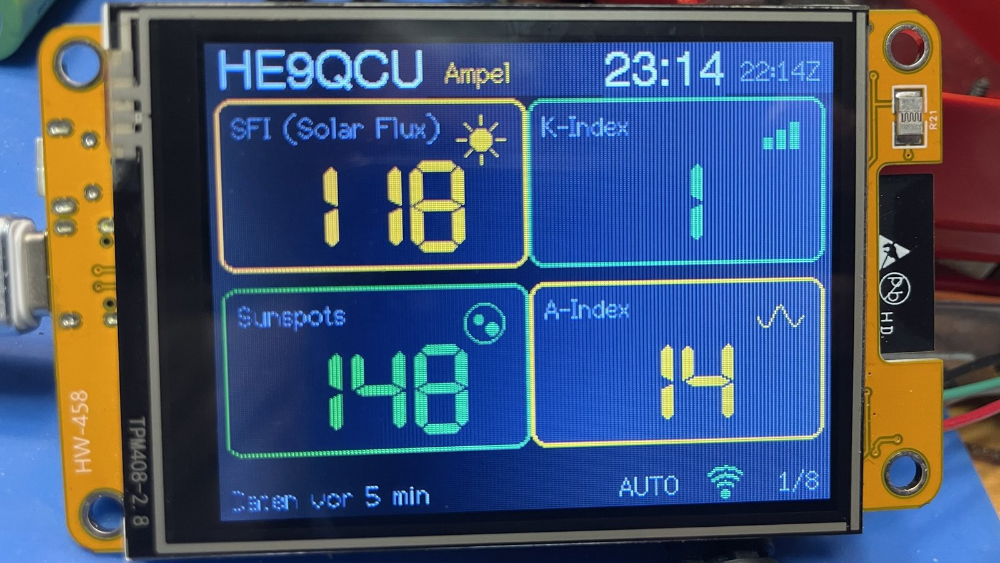

### Seite 2: Greyline (Sonne)

Ein Bogen zeigt den Weg der Sonne: links Aufgang, rechts Untergang. Ein gelber Punkt zeigt, wo die Sonne gerade steht. Nachts wandert stattdessen der Mond unter dem Horizont. Darunter stehen die Zeiten und die Tageslänge, und ein Countdown sagt, wie lange es noch bis zum nächsten Aufgang oder Untergang dauert.

**Grayline:** In der halben Stunde vor und nach Auf- und Untergang läuft die Dämmerungszone über die Erde. Dort sind die tiefen Bänder (160 m, 80 m, 40 m) oft besonders gut, weil die Signale dann weite Wege schaffen. Die Seite meldet «GRAYLINE AKTIV» in Gelb. Das ist eine bewährte Faustregel, keine Garantie.

**Was bringt es dir?** Du planst Funkzeiten. Wer um Sonnenauf- und -untergang auf den tiefen Bändern (160 m, 80 m, 40 m) funkt, hat oft die besten Chancen auf weite Verbindungen (DX).

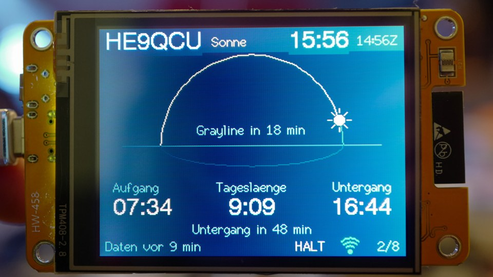
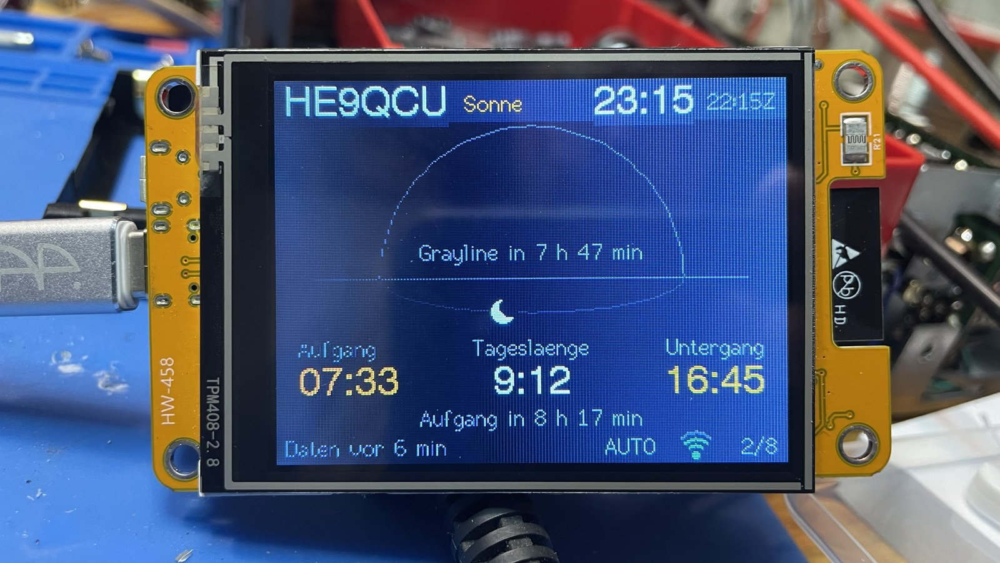

Die Zeiten rechnet das Gerät selbst aus (Genauigkeit etwa 1 bis 2 Minuten). Als Standort gilt Frauenfeld, du kannst ihn im Menü ändern.

### Seite 3: Bands (Bänder)

8 Spalten für die Bänder 80, 40, 30, 20, 17, 15, 12 und 10 Meter. Oben die Tag-Balken (Sonne), unten die Nacht-Balken (Mond). Die Zeile, die gerade gilt, leuchtet hell, die andere ist gedämpft. Darunter stehen die Zahlen SFI, K und A.

160 m fehlt hier mit Absicht: Die Prognosequelle kennt es nicht. 160 m findest du auf der WSPR-Seite.

**Was bringt es dir?** Du weisst, auf welchem Band du jetzt anfangen solltest, und ob es sich tagsüber oder nachts mehr lohnt. Statt alle Bänder durchzudrehen, gehst du gleich zum grünen Balken.

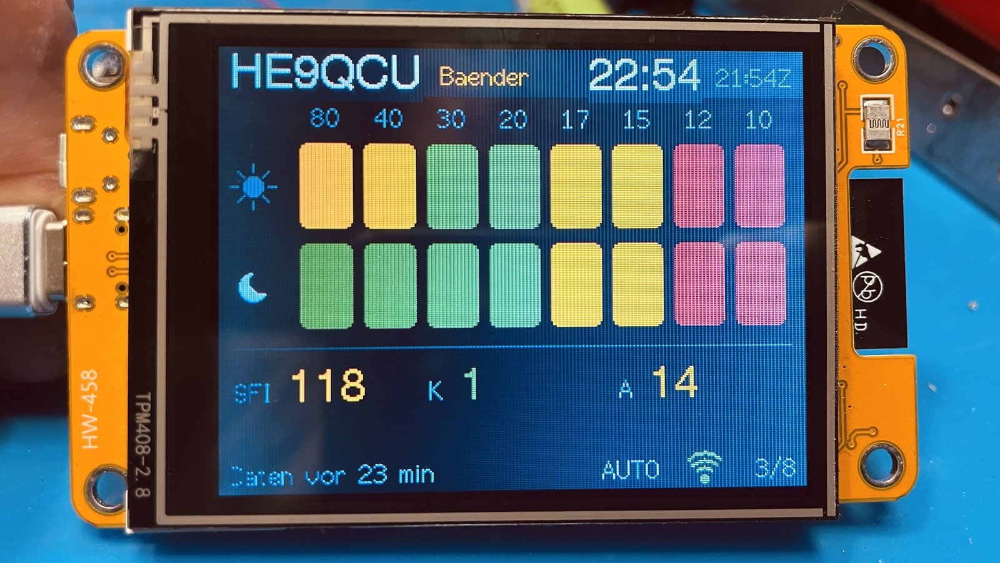

### Seite 4: Mode (Betriebsart)

Dieselben 8 Bänder, aber getrennt nach **SSB** (Sprechfunk) und **CW** (Morsen, dazu Digitalmodi wie FT8). Standardmässig steht SSB oben, du kannst die Reihenfolge ändern.

Warum zwei Blöcke? Morsen und FT8 kommen mit viel schwächeren Signalen aus als Sprechfunk. Deshalb bewertet die Bandampel CW und Digital eine Stufe besser. Ist das Erdmagnetfeld gestört (K ab 5), wird für beide eine Stufe abgezogen. Das ist eine Faustregel, keine Prognose.

**Was bringt es dir?** Ist die Ausbreitung nur mittelmässig, geht Sprechfunk (SSB) oft nicht mehr, Morsen (CW) oder FT8 aber schon. Die Seite zeigt dir, wann sich der Wechsel der Betriebsart lohnt.

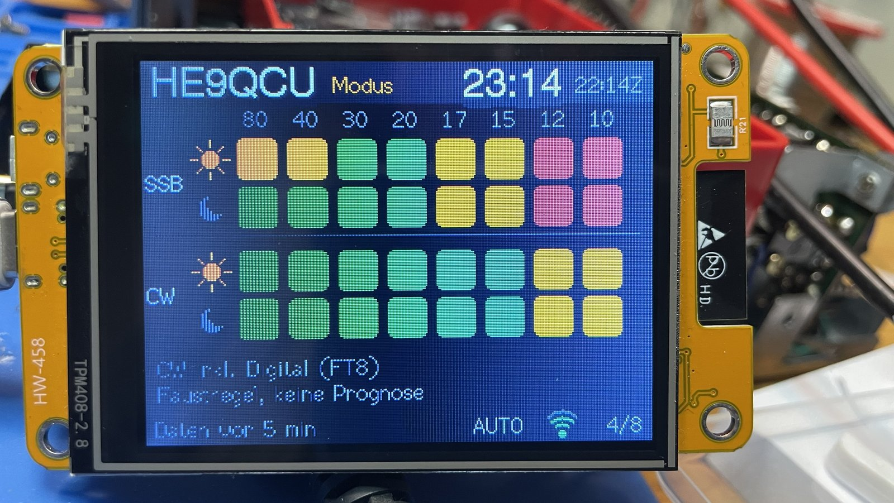

### Seite 5: WSPR (Live)

Hier wird nicht prognostiziert, sondern gemessen. Funkamateure auf der ganzen Welt melden mit WSPR (einem Spezialmodus für schwache Signale) jede gehörte Station. Die Bandampel zählt, wie viele Meldungen in den letzten 30 Minuten aus deiner Region kamen. Viele Meldungen heissen: Das Band lebt. Es gibt 9 Balken, 160 m inklusive.

Bei den Balken steht die Anzahl der Meldungen. Die Region ist standardmässig Mitteleuropa (Locator-Felder JN und JO). Die Farbschwellen sind noch geschätzt und werden nach Erfahrung angepasst.

**Was bringt es dir?** Ein Realitätscheck: Die Prognose sagt, was möglich wäre, WSPR zeigt, was gerade wirklich ankommt. Sind viele Meldungen da, ist das Band offen, auch wenn die Prognose zurückhaltend ist.

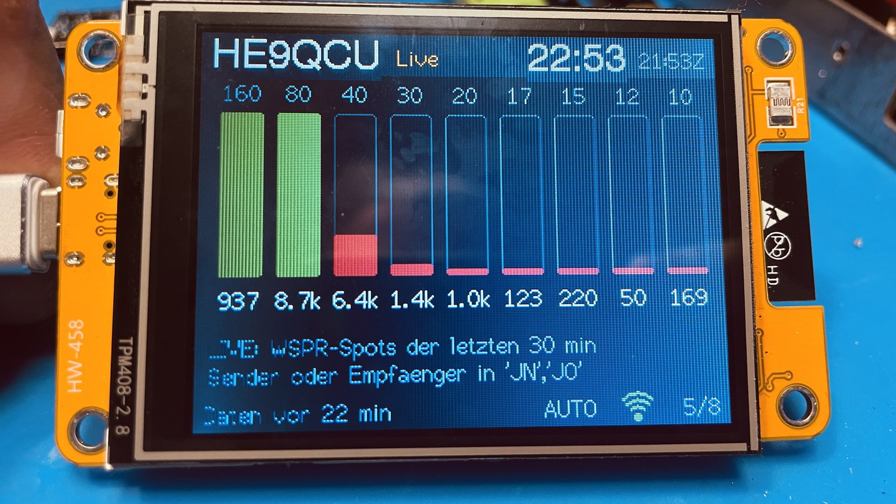

**Wichtig:** Die WSPR-Seite braucht nach dem Einschalten ein paar Minuten, bis die erste Abfrage da ist. Danach aktualisiert sie sich alle 15 Minuten.

### Seite 6: Space Wx (Weltraumwetter)

4 Karten mit Farbrahmen für alles, was sonst noch auf die Ausbreitung drückt:

- **X-Ray (Flares):** Sonneneruptionen. Klasse A oder B ist ruhig, C leicht erhöht, M oder X bedeutet Funkstörung auf der Tagseite.
- **Sonnenwind:** Wie schnell die Teilchen der Sonne bei uns ankommen. Unter 400 km/s ruhig, unter 600 erhöht, darüber schnell.
- **Magnetfeld Bz:** Zeigt es nach Süden (negativ), kann das Erdmagnetfeld ins Wanken kommen. Ab minus 3 nT unruhig, ab minus 8 gestört.
- **Rauschen:** Wie laut das Grundrauschen auf den Bändern ist (S-Stufen). S0 bis S1 leise, S2 bis S3 mittel, ab S4 laut.

**Was bringt es dir?** Du verstehst, warum ein Band trotz guter Prognose schweigt: Ein Flare oder ein Magnetsturm hat es gerade gestört. Dann sparst du dir die Fehlersuche an der Antenne und wartest ab.

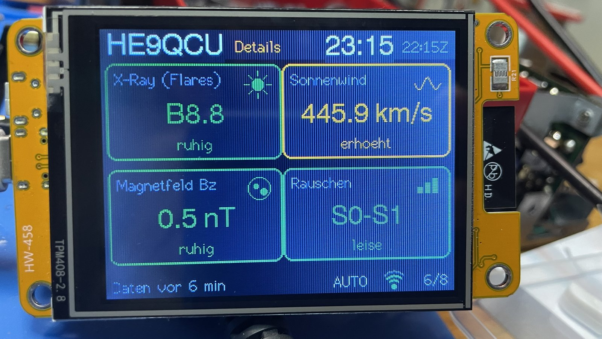

### Seite 7: Info

Die technische Seite für Neugierige: ganz oben die Firmware-Version (die Nummer brauchst du, wenn du Hilfe suchst), dann WLAN-Name, IP-Adresse, Signalstärke, der Name des Geräts im Netz, das Alter der Daten und die Laufzeit seit dem Einschalten. Praktisch, wenn du das Web-Menü öffnen willst und die Adresse suchst.

**Was bringt es dir?** Hier suchst du die Adresse für das Web-Menü und siehst bei Problemen sofort, ob WLAN und Daten in Ordnung sind.

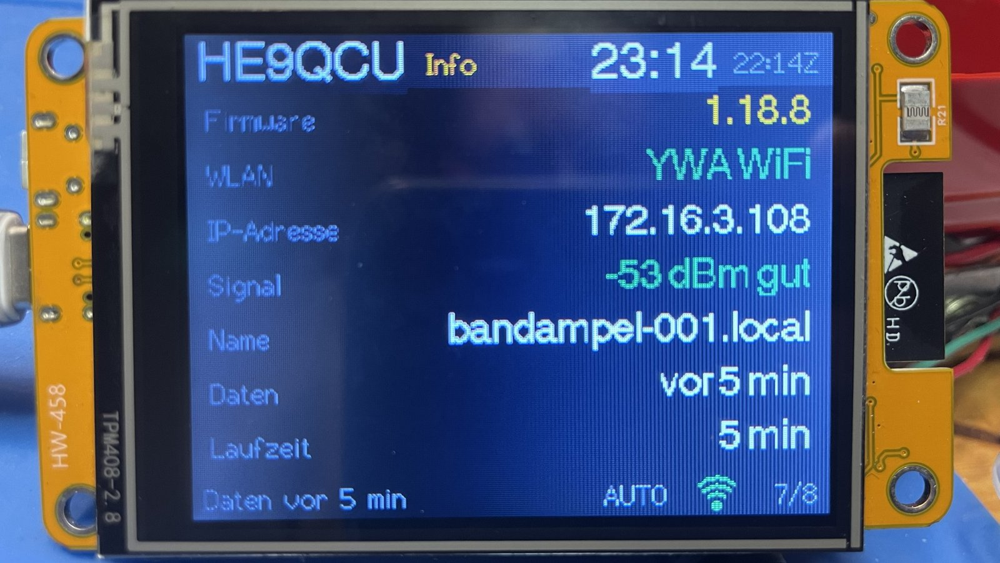

### Seite 8: About (Über)

Version, Urheber, Lizenzen, Datenquellen und ein **QR-Code**, der direkt zum Projekt auf GitHub führt. Einfach mit dem Handy scannen.

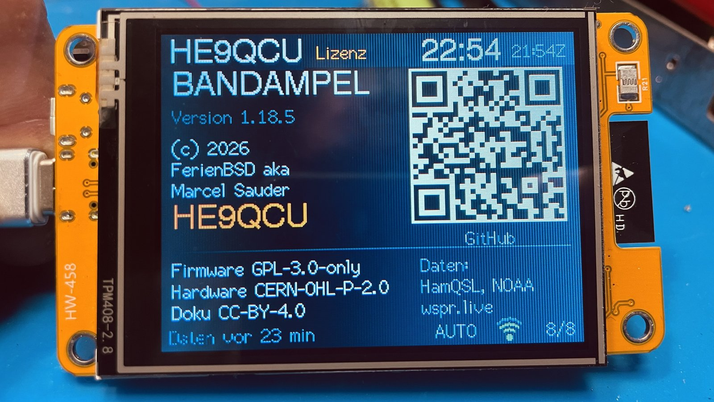

---

## 4. Bedienen

Die Bandampel hat 2 Wege der Bedienung: das Display und die Tasten.

| Was du tust | Was passiert |
|---|---|
| Display kurz antippen | Nächste Seite |
| BOOT-Taste kurz drücken | Nächste Seite |
| Display oder BOOT-Taste ca. 1 Sekunde halten | Zwischen AUTO und HALT umschalten |
| BOOT-Taste 10 Sekunden halten | Werkseinstellung (siehe Kapitel 8) |
| RESET-Taste (EN) drücken | Das Gerät startet neu, sonst nichts |

AUTO ist der Normalzustand: Die Seiten wechseln alle 10 Sekunden (einstellbar). Willst du in Ruhe eine Seite studieren, halte den Finger kurz länger auf das Display, und es steht «HALT» unten. Noch einmal lang halten, und es läuft wieder.

**BOOT oder RESET?** Auf der Rückseite sitzen 2 kleine Tasten. RESET startet das Gerät neu, dabei wird das Display kurz dunkel. BOOT wechselt Seiten und löst bei 10 Sekunden die Werkseinstellung aus. Die RESET-Taste ist harmlos, sie löscht nichts.

---

## 5. Die erste Inbetriebnahme

1. **Strom anschliessen:** USB-C oder Micro-USB, ein normales Handy-Netzteil genügt.
2. **WLAN:** Hat dir jemand das Gerät fertig eingerichtet, verbindet es sich selbst. Das WLAN-Symbol in der Fusszeile wird grün.
3. **Noch kein WLAN eingetragen?** Dann öffnet das Gerät nach etwa 60 Sekunden ein eigenes WLAN namens **«Bandampel-Setup»**. Verbinde dein Handy damit, öffne im Browser `http://192.168.4.1` und trage im Reiter «WLAN» dein Netz ein (Kapitel 6).
4. **Rufzeichen eintragen:** Reiter «Funk». Fertig.

Die Bandampel unterstützt nur **2,4 GHz**. Dein Router kann beides, aber das Gerät sieht nur 2,4 GHz. Beim iPhone-Hotspot musst du «Kompatibilität maximieren» einschalten, sonst sendet der Hotspot auf 5 GHz und die Bandampel findet ihn nicht.

---

## 6. Das Web-Menü

Alle Einstellungen laufen über den Browser, am Handy, Tablet oder Computer. Dein Gerät muss im selben WLAN sein.

**Aufrufen:** Im Browser `http://bandampel-001.local` eingeben (die Nummer ist die Gerätenummer). Geht das bei dir nicht, nimm die IP-Adresse von der Seite «Info» auf dem Display, zum Beispiel `http://192.168.1.50`.

**Speichern:** Unten klebt immer der gelbe Knopf **«Speichern und neu starten»**. Er speichert alle Reiter auf einmal. Danach startet das Gerät neu, das dauert etwa 10 Sekunden. Das Menü funktioniert im Hoch- und Querformat.

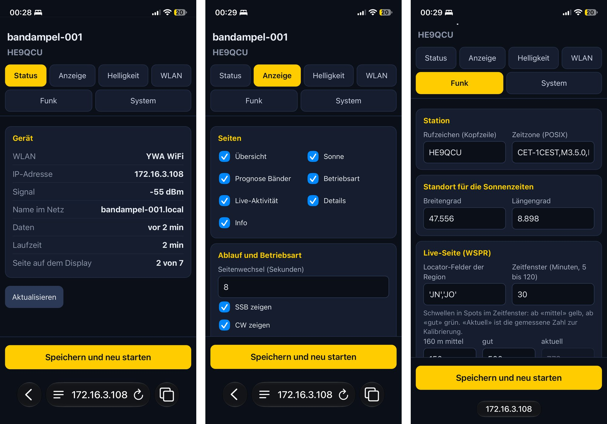

Das Menü hat 7 Reiter, die wichtigsten zuerst.

### Reiter «Status»

Nur zum Anschauen: WLAN, IP, Signal, Version, Name im Netz, Alter der Daten, Laufzeit, aktuelle Seite.

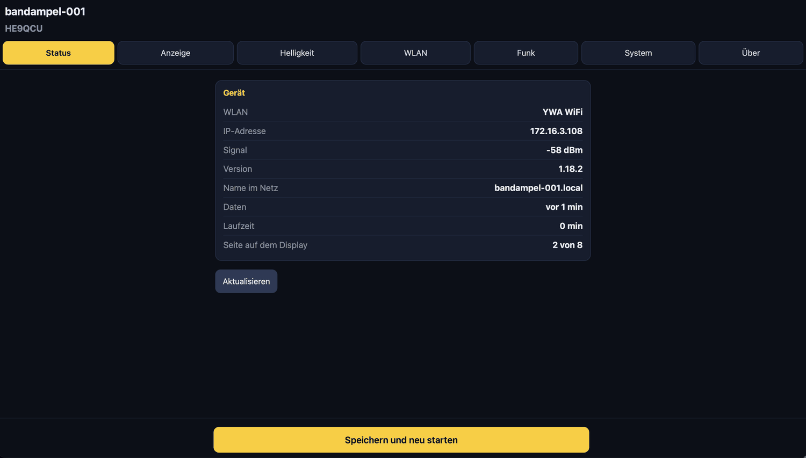

### Reiter «Anzeige»

- **Seiten:** Jede Seite lässt sich einzeln ausschalten. Wer Space Wx nicht braucht, schaltet die Seite ab.
- **Seitenwechsel:** Wie viele Sekunden jede Seite im AUTO-Modus steht.
- **SSB, CW:** Zeigen oder verstecken, und welche Betriebsart oben steht.

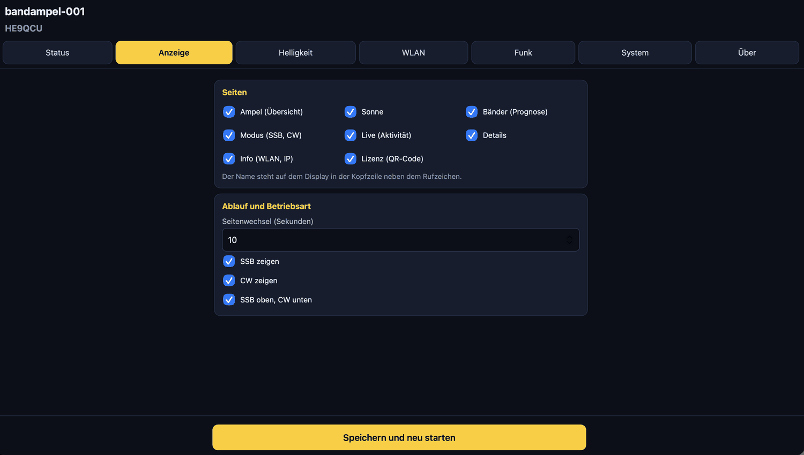

### Reiter «Helligkeit»

- **Modus:** «Fest» (immer gleich hell), «Tag oder Nacht mit Schwelle» oder «Stufenlos nach Lichtsensor» (empfohlen).
- **Tag und Nacht in Prozent:** Weniger Helligkeit spart Strom und Wärme.
- **Kalibrierung:** Raum hell machen, «Aktuell als hell» drücken. Dann den Sensor (kleiner Punkt neben dem Display) abdecken, «Aktuell als dunkel» drücken. Speichern, fertig.

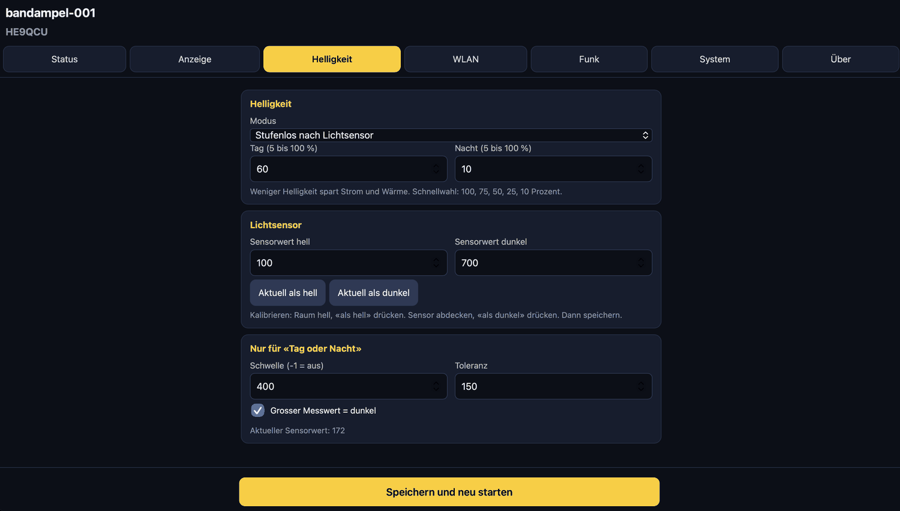

### Reiter «WLAN»

- **Bis zu 5 Netze**, das Gerät probiert sie der Reihe nach durch.
- **Netze suchen:** Zeigt, welche WLANs gerade in der Nähe sind. Tippe ins Namensfeld und wähle eins aus. So gibt es keine Tippfehler mehr.
- **Passwort:** Wird nie angezeigt. Leer lassen heisst: bleibt unverändert. Änderst du den Namen eines Netzes, gib das Passwort neu ein.
- **Pause zwischen Versuchen:** Wenn das Netz weg ist, versucht das Gerät es in diesem Abstand wieder.

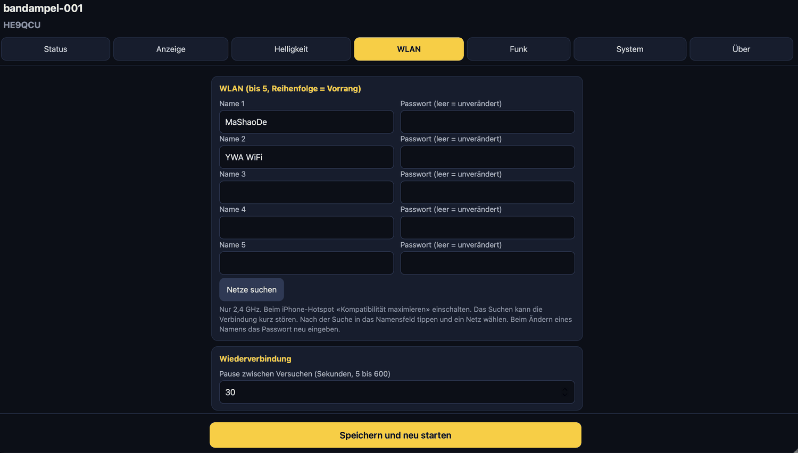

### Reiter «Funk»

- **Rufzeichen:** Erscheint in der Kopfzeile.
- **Zeitzone:** Standard ist Zürich mit automatischer Sommerzeit.
- **Standort:** Breite und Länge für die Sonnenzeiten.
- **WSPR-Seite:** Region (Locator-Felder), Zeitfenster und die Farbschwellen für jedes Band. Daneben steht die aktuelle Zahl, damit du die Schwellen nach Gefühl einstellen kannst.

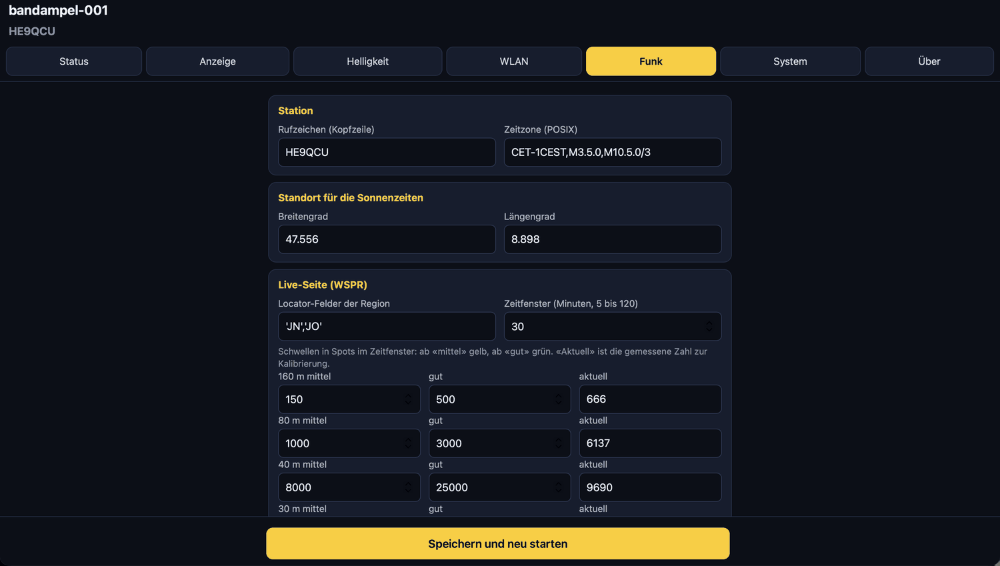
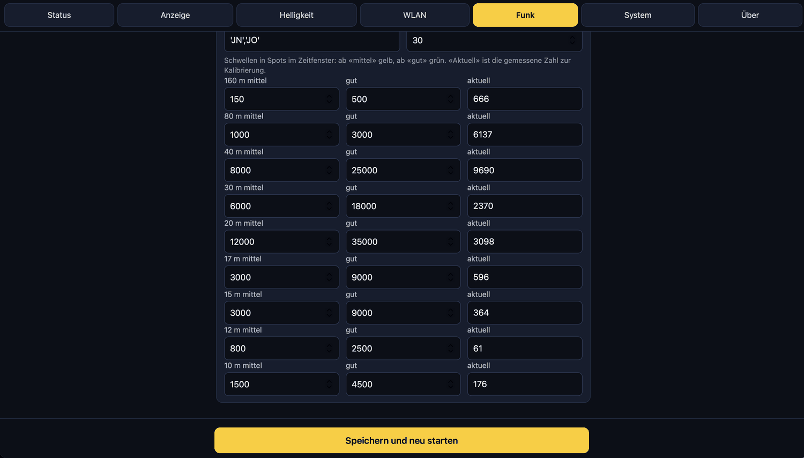

### Reiter «System»

- **Gerätenummer:** 1 bis 999. Der Name im Netz heisst dann `bandampel-001.local`, `bandampel-002.local` und so weiter. So laufen mehrere Geräte nebeneinander.
- **Menü-Passwort:** Leer heisst: kein Passwort. Mit Passwort fragt der Browser beim Öffnen nach (Benutzername: `admin`).
- **Werkseinstellung:** Löscht alle gespeicherten Einstellungen. Zur Sicherheit musst du das Menü-Passwort eingeben (oder `000000`, wenn keins gesetzt ist).

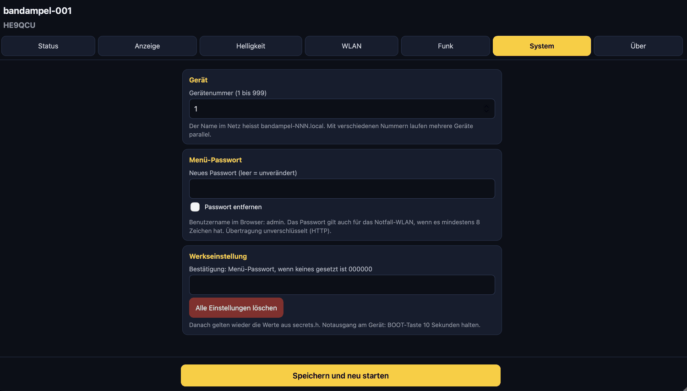

### Reiter «Über»

Version, Urheber, Lizenzen, Datenquellen und der Link zum Projekt auf GitHub. Hier lässt sich nichts ändern.

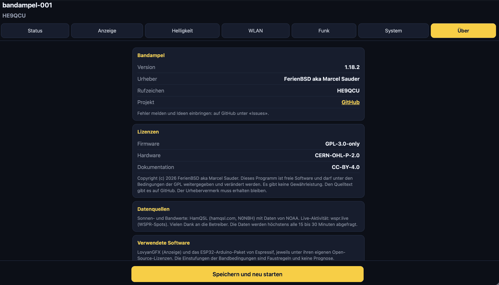

---

## 7. Helligkeit und Nachtmodus

Die Bandampel hat einen kleinen Lichtsensor. Im Modus «Stufenlos» passt sie die Helligkeit gleitend an: Bei Tageslicht leuchtet sie mit dem Tageswert (Standard 60 Prozent), im dunklen Zimmer mit dem Nachtwert (Standard 10 Prozent). Die Übergänge sind sanft, sie springt also nicht, wenn jemand am Sensor vorbeigeht.

Wenn die Helligkeit nicht passt:
- Zu hell nachts: Nachtwert im Menü senken.
- Zu dunkel am Tag: Tageswert erhöhen.
- Reagiert zu früh oder zu spät: Kalibrierung neu machen (Reiter «Helligkeit»).

---

## 8. Notausgang: BOOT-Taste

Wenn das Web-Menü nicht mehr erreichbar ist (zum Beispiel wegen eines Tippfehlers im WLAN-Namen) oder du alles zurücksetzen willst:

1. Im normalen Betrieb die **BOOT-Taste halten**.
2. Nach 5 Sekunden erscheint ein roter Countdown.
3. **Loslassen bricht ab**, es passiert nichts.
4. Bei 0 löscht das Gerät alle gespeicherten Einstellungen und startet neu.

Danach gelten wieder die Vorgaben, die in der Firmware stehen (Datei `secrets.h` beim Selbstbau). Findet das Gerät kein bekanntes WLAN, öffnet es nach 60 Sekunden das Notfall-WLAN «Bandampel-Setup».

Die Taste darf beim **Einschalten nicht gedrückt** sein. Sonst startet der ESP32 in den Programmiermodus. Das ist harmlos, ein kurzer Druck auf RESET behebt es.

---

## 9. Selbstbau und Firmware

Wer das Gerät selbst bauen will: Du brauchst ein fertiges Board vom Typ **ESP32-2432S028** (das «Cheap Yellow Display», CYD, auch als Board mit 2 USB-Anschlüssen), ein USB-Kabel mit Datenleitungen und einen Computer (Windows oder macOS). Löten ist nicht nötig. Die ganze Anleitung steht in [Nachbauen.md](Nachbauen.md). Es gibt 2 Wege, nimm einen von beiden:

- **Arduino IDE** (mit Maus, empfohlen für den Einstieg): Programm installieren, Board und Bibliothek LovyanGFX über die Menüs holen, `bandampel.ino` öffnen, bei «Werkzeuge» das Board «ESP32 Dev Module» und die Flash-Aufteilung «Huge APP (3MB No OTA/1MB SPIFFS)» wählen, Anschluss auswählen und «Hochladen» drücken.
- **arduino-cli** (Terminal): `arduino-cli compile firmware/bandampel && arduino-cli upload -p <Port> firmware/bandampel`. Die Datei `sketch.yaml` im Sketch-Ordner stellt Board und Speicheraufteilung automatisch richtig ein.

Bei beiden Wegen gilt vorher: `secrets.h.example` zu `secrets.h` kopieren und das WLAN eintragen (ohne diese Datei lässt sich das Programm nicht kompilieren). Wichtig bei der Arduino IDE: Die Flash-Aufteilung «Huge APP» muss von Hand gewählt werden, sonst ist das Programm zu gross und das Kompilieren bricht ab.

Technik zum Programm (Kompilieren, Seriell Monitor, Anpassen): [Firmware_V1.md](Firmware_V1.md).

---

## 10. Wenn etwas klemmt

**Das WLAN-Symbol ist rot.**
Das Gerät findet dein Netz nicht. Prüfe: Ist es ein 2,4-GHz-Netz? Stimmt der Name, auch Gross und Kleinschreibung? Beim iPhone-Hotspot «Kompatibilität maximieren» einschalten. Das Gerät versucht es automatisch immer wieder. Nach 60 Sekunden öffnet es «Bandampel-Setup» zur Korrektur.

**Alle Felder zeigen «--».**
Das Gerät hat noch keine Daten. Es braucht nach dem Start etwa eine Minute. Bleibt es dabei, ist das WLAN weg (rotes Symbol).

**Die Daten sind alt.**
Die Quelle HamQSL aktualisiert sich alle paar Stunden. «Daten vor 3 h» ist normal.

**Die WSPR-Seite ist leer.**
Sie holt sich ihre Daten alle 15 Minuten, nach dem Start dauert es etwas. Ist die Region falsch eingestellt, fehlen die Meldungen. Standard ist JN und JO.

**Die Uhrzeit stimmt nicht.**
Die Zeit kommt aus dem Internet und braucht WLAN. Zeitzone im Reiter «Funk» prüfen.

**Ich komme nicht ins Menü.**
Läuft das Gerät im gleichen WLAN? Die IP von der Seite «Info» probieren. Das Handy darf nicht im Mobilfunk-Modus sein. Als Letztes: BOOT-Taste 10 Sekunden halten (Kapitel 8).

**Die Farben sehen etwas komisch aus.**
Beim Board mit 2 USB-Anschlüssen wirkt das Display etwas bläulich. Wir haben mehrere Einstellungen getestet, keine hat den Stich behoben. Die Bandampel funktioniert trotzdem.

**Das Display ist nachts zu hell oder zu dunkel.**
Siehe Kapitel 7.

**Der Sketch ist zu gross (nur Selbstbau).**
Stelle in `sketch.yaml` die Flash-Aufteilung «Huge APP» ein, das ist im Repository schon so eingestellt.

---

## 11. Kleines Glossar

| Begriff | Bedeutung |
|---|---|
| **SFI** | Solar Flux Index: Strahlung der Sonne bei 10,7 cm, ein Mass für die Sonnenaktivität |
| **K-Index** | Unruhe des Erdmagnetfelds, Skala 0 bis 9 |
| **A-Index** | Tagesmittel der Unruhe, Skala 0 bis über 100 |
| **Sunspots** | Sonnenflecken, mehr Flecken gleich bessere Ausbreitung |
| **X-Ray** | Röntgenstrahlung der Sonne, Klassen A, B, C, M, X |
| **Bz** | Nord-Süd-Komponente des Magnetfelds im Sonnenwind |
| **WSPR** | Spezialmodus, der mit winzigen Sendeleistungen die ganze Welt erreicht |
| **Grayline** | Dämmerungszone an der Grenze zwischen Tag und Nacht |
| **SSB** | Einseitenband, die übliche Sprechfunk-Betriebsart |
| **CW** | Morsetelegrafie |
| **FT8** | Digitalmodus für sehr schwache Signale |
| **Propagation** | Ausbreitung der Funkwellen: Wie gut Signale über die Ionosphäre weite Strecken schaffen |
| **Band** | Frequenzbereich, benannt nach der Wellenlänge. Ungefähr: 160 m = 1,8 MHz, 80 m = 3,5 MHz, 40 m = 7 MHz, 30 m = 10 MHz, 20 m = 14 MHz, 17 m = 18 MHz, 15 m = 21 MHz, 12 m = 24 MHz, 10 m = 28 MHz |
| **Mode** | Betriebsart, zum Beispiel SSB, CW oder FT8 |
| **Space Wx** | Weltraumwetter (Wx ist die Funkerabkürzung für Wetter): Flares, Sonnenwind, Magnetfeld |
| **Solar** | Hier: die Sonnenwerte SFI, K, A und Sunspots |
| **Ionosphäre** | Hohe Luftschicht, die Kurzwelle zur Erde zurückwirft |
| **Locator** | Gitterfeld-Kennung für einen Standort, zum Beispiel JN47. Die ersten 2 Buchstaben sind das grosse Feld (Mitteleuropa: JN und JO) |
| **DX** | Weite Verbindungen, meist über Tausende Kilometer |
| **S-Stufen** | Skala für die Signalstärke (S-Meter). Hier für das Grundrauschen genutzt |
| **UTC / Zulu** | Weltzeit, unabhängig von Zeitzone und Sommerzeit |
| **ESP32** | Der kleine Computer im Gerät |
| **CYD** | «Cheap Yellow Display», das fertige Board, auf dem die Bandampel läuft |

---

## 12. Lizenz, Quellen, Kontakt

- **Urheber:** FerienBSD aka Marcel Sauder, Rufzeichen HE9QCU.
- **Lizenzen:** Firmware GPL-3.0-only, Hardware CERN-OHL-P-2.0, Dokumentation CC-BY-4.0. Das heisst: Du darfst alles benutzen, verändern und weitergeben, solange der Urhebervermerk bleibt und der Quelltext offen bleibt. Es gibt keine Gewährleistung.
- **Datenquellen:** HamQSL (hamqsl.com, N0NBH) mit Daten von NOAA SWPC für die Sonnen- und Bandwerte. wspr.live für die Live-Aktivität. Vielen Dank an die Betreiber. Die Quellen sind für nicht-kommerzielle Nutzung gedacht und werden nur alle 15 bis 30 Minuten abgefragt.
- **Projekt und Kontakt:** [github.com/MaShaoDe/Bandampel](https://github.com/MaShaoDe/Bandampel). Fehler melden und Ideen einbringen über «Issues». Oder per Funk an HE9QCU.
- **Platinen und Bausätze:** Bastlerprojekt. Auf Anfrage zum Materialpreis, solange Vorrat, ohne Gewährleistung und ohne CE-Prüfung, Betrieb auf eigene Verantwortung. Gemeinsame Lötworkshops sind möglich.

*73 und gute DX!*
